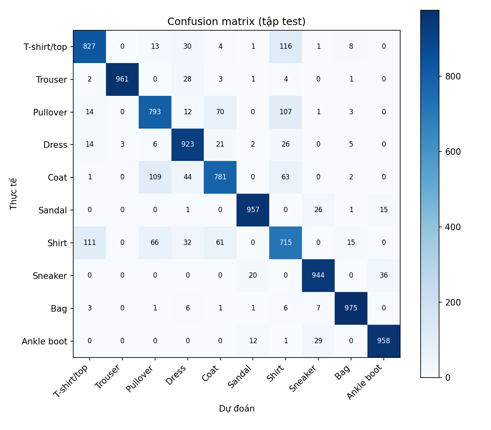
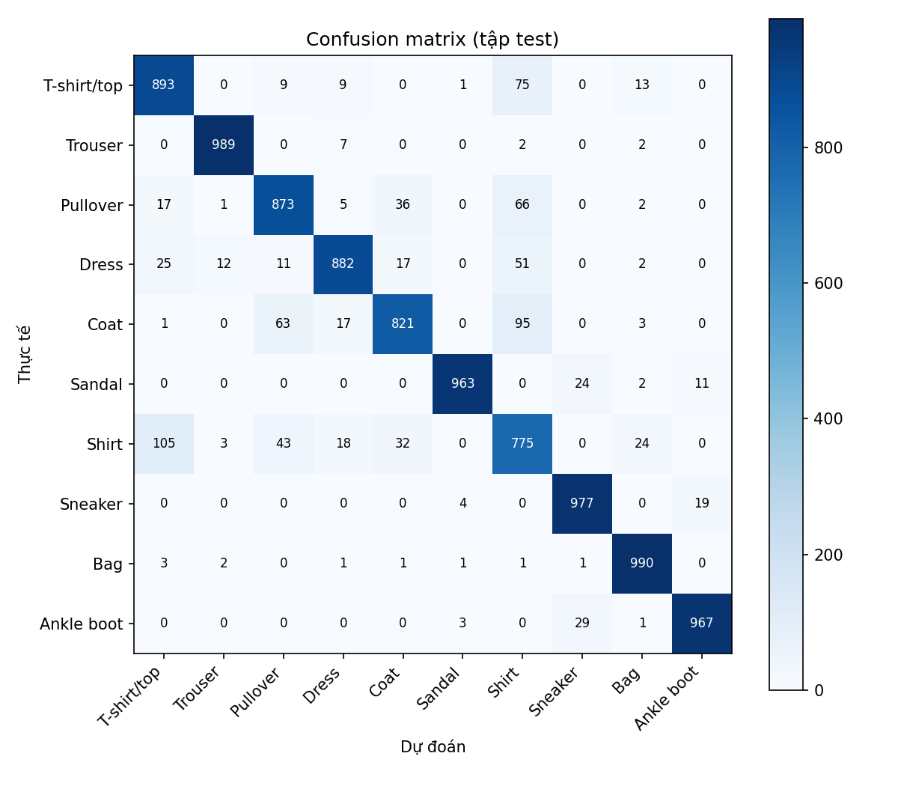

# FashionMNIST Classification with PyTorch — Chapter 2 Practice 1

> **Chapter 2 – Artificial Neural Networks | Practice 1**  
> Bài thực hành phân loại ảnh FashionMNIST bằng PyTorch. Trọng tâm: thử nghiệm cấu trúc mạng, trực quan hóa loss và hiển thị ảnh dự đoán so với nhãn thực tế.

**Phạm vi:** thực hành quy trình PyTorch theo đề bài. MLP và CNN là hai cấu trúc mạng dùng cho Task 1; so sánh kết quả chỉ là phần hỗ trợ, không phải mục tiêu chính.

---

## 1. Mục tiêu

- Thực hành Tensor, Dataset, DataLoader và transforms trong PyTorch.
- Khảo sát dữ liệu ảnh FashionMNIST và thực hiện EDA.
- Xây dựng MLP và CNN để phân loại ảnh thành 10 lớp.
- Hiểu training loop: forward → loss → backward → optimizer update.
- Theo dõi train/validation loss, accuracy và sử dụng early stopping.
- Đánh giá trên test set bằng Accuracy, Precision, Recall, Macro-F1 và Confusion Matrix.
- Thực hiện data audit, lưu/nạp checkpoint và dự đoán ảnh mới.
- Thử nghiệm cấu trúc mạng MLP và CNN để đáp ứng Task 1.
- Trực quan hóa train loss và validation loss theo epoch để đáp ứng Task 2.
- Hiển thị ảnh FashionMNIST cùng nhãn thực tế và nhãn dự đoán để đáp ứng Task 3.

## 2. Công nghệ sử dụng

| Thành phần | Công cụ |
|---|---|
| Ngôn ngữ | Python |
| Deep learning | PyTorch, Torchvision |
| Xử lý dữ liệu | NumPy, Pandas |
| EDA và biểu đồ | Matplotlib |
| PCA và metrics | Scikit-learn |
| Cấu hình | YAML |
| Kiểm thử | Pytest |
| Báo cáo | Markdown, HTML, DOCX |

Khuyến nghị Python 3.10 hoặc 3.11. Cài phiên bản PyTorch CPU/CUDA phù hợp với máy tại trang [PyTorch Get Started](https://pytorch.org/get-started/locally/).

## 3. Dataset: FashionMNIST

FashionMNIST là bộ dữ liệu phân loại ảnh thời trang gồm 70.000 ảnh grayscale kích thước 28 × 28, mỗi ảnh thuộc một trong 10 lớp.

| Label | Class |
|---:|---|
| 0 | T-shirt/top |
| 1 | Trouser |
| 2 | Pullover |
| 3 | Dress |
| 4 | Coat |
| 5 | Sandal |
| 6 | Shirt |
| 7 | Sneaker |
| 8 | Bag |
| 9 | Ankle boot |

### 3.1. Chia dữ liệu

| Split | Số ảnh | Mục đích |
|---|---:|---|
| Train | 50.000 | Cập nhật trọng số |
| Validation | 10.000 | Theo dõi mô hình, chọn checkpoint |
| Test | 10.000 | Đánh giá cuối cùng |

60.000 ảnh train gốc được chia thành train/validation bằng seed 42. Test set gốc được giữ riêng. Không dùng test set để tính mean/std hoặc chọn hyperparameter.

### 3.2. Tiền xử lý

- Ảnh thô có kiểu `uint8`, miền pixel [0, 255].
- Chuyển pixel về [0, 1].
- Tính mean/std chỉ trên training split.
- Chuẩn hóa z-score: `x_norm = (x - mean_train) / std_train`.
- CNN nhận tensor `(B, 1, 28, 28)`.
- MLP Flatten ảnh thành vector 784 chiều.

Thống kê chuẩn hóa được ghi trong audit: mean = **0,2858626**, std = **0,3529320**.

## 4. EDA — Exploratory Data Analysis

Notebook `notebooks/01_data_analysis_and_experiments.ipynb` thực hiện:

1. **Tổng quan dữ liệu:** 60.000 ảnh train, 10.000 ảnh test; ảnh 28 × 28, grayscale, 10 lớp.
2. **Cleaning:** kiểm tra nhãn hợp lệ, ảnh trống, ảnh trùng lặp trong train và ảnh trùng giữa train/test.
3. **Class distribution:** dữ liệu gốc cân bằng, mỗi lớp có 6.000 ảnh train và 1.000 ảnh test.
4. **Image visualization:** hiển thị ảnh mẫu của từng lớp.
5. **Class mean images:** tính ảnh trung bình theo từng lớp.
6. **Pixel statistics:** mean toàn bộ ảnh train khoảng 0,2860; std khoảng 0,3530; tỷ lệ pixel bằng 0 khoảng 50,21%.
7. **Class similarity:** khoảng cách Euclid giữa ảnh trung bình của các lớp.
8. **PCA:** thử trên mẫu ngẫu nhiên 6.000 ảnh; 50 thành phần chính giữ khoảng 86,3% phương sai.
9. **Train/validation split:** chia bằng seed 42 và kiểm tra phân phối từng lớp.
10. **Normalization và DataLoader:** kiểm tra shape, dtype và kết quả chuẩn hóa.

Kết quả cleaning đã lưu trong output notebook: 0 ảnh trống, 0 ảnh trùng lặp trong train và 0 ảnh train trùng chính xác với test. Đây là kiểm tra trùng ảnh theo nội dung pixel, không phải đánh giá trùng lặp ngữ nghĩa.

### 4.1. Một số cặp lớp có ảnh trung bình gần nhau

| Cặp lớp | Khoảng cách Euclid |
|---|---:|
| Pullover – Coat | 2,48 |
| Pullover – Shirt | 2,68 |
| Coat – Shirt | 3,02 |
| T-shirt/top – Shirt | 3,72 |
| Sandal – Sneaker | 3,84 |

Các cặp áo có hình dáng tương tự là nhóm đáng chú ý khi phân tích lỗi phân loại. Khoảng cách ảnh trung bình chỉ là tín hiệu khám phá dữ liệu, không phải bằng chứng trực tiếp rằng mô hình chắc chắn nhầm hai lớp.

## 5. Task 1 — Thử nghiệm cấu trúc mạng

### 5.1. MLP

- Input: ảnh 1 × 28 × 28 được Flatten thành 784 features.
- Hidden layers: Linear(784, 256) → ReLU → Dropout(0,2) → Linear(256, 128) → ReLU → Dropout(0,2).
- Output: Linear(128, 10) tạo logits.
- Số tham số: **235.146**.

MLP là baseline đơn giản, nhưng Flatten làm mất cấu trúc không gian hai chiều của ảnh.

### 5.2. CNN

- Input: tensor ảnh 1 × 28 × 28.
- Ba khối convolution với số kênh 32, 64 và 128.
- Mỗi khối sử dụng BatchNorm và ReLU; hai khối đầu có MaxPooling.
- Adaptive Average Pooling về 3 × 3.
- Classifier: Flatten → Linear(1152, 128) → ReLU → Dropout(0,25) → Linear(128, 10).
- Số tham số: **241.994**.

CNN giữ thông tin không gian và học các đặc trưng cục bộ thông qua convolution.

### 5.3. Training loop

Mỗi mini-batch thực hiện:

1. `optimizer.zero_grad()`: xóa gradient cũ.
2. Forward: tính logits từ ảnh đầu vào.
3. Loss: tính CrossEntropyLoss giữa logits và nhãn.
4. Backward: `loss.backward()`.
5. Update: `optimizer.step()`.
6. Sau mỗi epoch, chạy validation để theo dõi và chọn trọng số tốt nhất.

`src.train.fit()` khôi phục checkpoint có **validation accuracy tốt nhất**, không mặc định lấy epoch cuối. AMP chỉ bật khi cấu hình cho phép và thiết bị là CUDA.

## 6. Cài đặt môi trường

Mở PowerShell tại thư mục `fashionmnist_lab`:

```powershell
python -m venv .venv
.venv\Scripts\Activate.ps1
python -m pip install --upgrade pip
pip install -r requirements.txt
```

Cài PyTorch CPU/CUDA tương thích theo hướng dẫn chính thức: https://pytorch.org/get-started/locally/

## 7. Chạy dự án

### 7.1. Kiểm tra dữ liệu và model

```powershell
python -m src.dataset
python -m src.model
python -m src.data_audit
```

Audit sinh các file trong `reports/data_audit/`:
- `audit_summary.json`
- `audit_log.txt`
- `class_distribution.csv`
- `class_distribution.png`

### 7.2. Dry Run

```powershell
python -m src.train --dry-run
```

Dry Run chạy một epoch trên tập con nhỏ (train 50, validation 20, test 20), lưu vào `reports/dry_run/` và không ghi đè checkpoint chính.

### 7.3. Huấn luyện hai mô hình

```powershell
# CNN (default.yaml là cấu hình CNN mặc định)
python -m src.train --config configs/cnn.yaml

# MLP
python -m src.train --config configs/mlp.yaml
```

### 7.4. Đánh giá test

```powershell
python -m src.evaluate --config configs/cnn.yaml
python -m src.evaluate --config configs/mlp.yaml
```

Evaluation tải checkpoint tương ứng, kiểm tra mean/std và đánh giá trên test set.

### 7.5. Dự đoán một ảnh mới

```powershell
python -m src.predict --image path/to/image.png --checkpoint reports/cnn/fashion_mnist_cnn.pth
```

Ảnh đầu vào được chuyển grayscale, resize 28 × 28 và chuẩn hóa bằng mean/std lưu trong checkpoint.

### 7.6. Kiểm thử

```powershell
python -m pytest -q
```

### 7.7. Notebook

Mở `notebooks/01_data_analysis_and_experiments.ipynb` từ thư mục gốc dự án.

Kiểm tra notebook trước khi nộp: nội dung notebook trên repository cần được đồng bộ với pipeline `src.train` / `src.evaluate` và các kết quả thực nghiệm mới nhất.

## 8. Đối chiếu ba nhiệm vụ (Tasks) theo đề bài

### Task 1 — Thử nghiệm cấu trúc mạng / hyperparameters
Dùng MLP (Flatten + Linear) và CNN (Convolution + Pooling) làm hai cấu trúc mạng trong cùng pipeline. Các cấu hình dùng chung seed, batch size, optimizer, learning rate, weight decay và số epoch tối đa; khác biệt kiến trúc là nội dung được khảo sát. Đây là thí nghiệm về **cấu trúc mạng**, không phải cuộc thi thuật toán tổng quát.

### Task 2 — Visualize Loss
Sau mỗi epoch, src.train lưu train_loss và val_loss vào history.json; src.utils.plot_history() tạo training_curves.png. Notebook có biểu đồ loss theo epoch. Biểu đồ và số liệu phải đến từ cùng lần chạy cuối.

### Task 3 — Display predicted vs actual images
src.evaluate gọi show_predictions() để lưu predictions_random.png và predictions_wrong.png. Mỗi ảnh có nhãn dự đoán và nhãn thực tế trong ngoặc; màu xanh biểu thị đúng, màu đỏ biểu thị sai. Notebook và báo cáo cần hiển thị trực tiếp các ảnh này.

## 9. Cấu hình thực nghiệm

| Tham số | MLP | CNN |
|---|---:|---:|
| Seed | 42 | 42 |
| Batch size | 128 | 128 |
| Epoch tối đa | 15 | 15 |
| Optimizer | Adam | Adam |
| Learning rate | 0,001 | 0,001 |
| Loss | CrossEntropyLoss | CrossEntropyLoss |
| Weight decay | 0,0001 | 0,0001 |
| Early stopping patience | 4 | 4 |
| Dropout | 0,2 | 0,25 |

Cấu hình chi tiết nằm trong `configs/mlp.yaml` và `configs/cnn.yaml`.

## 10. Kết quả thực nghiệm hiện được lưu

| Chỉ số | MLP | CNN |
|---|---:|---:|
| Best validation accuracy | 89,15% | 92,25% |
| Test accuracy | 88,34% | 92,20% |
| Test Macro-F1 | 88,35% | 92,15% |
| Test loss | 0,3276 | 0,2331 |
| Training time | 15 s | 250 s |
| Inference latency | 0,067 ms/ảnh | 0,339 ms/ảnh |
| Parameters | 235.146 | 241.994 |
| Epoch thực chạy | 15 | 15 |

**Nhận xét:** CNN cao hơn MLP 3,86 điểm phần trăm về test accuracy và 3,80 điểm phần trăm về Macro-F1. CNN có test loss thấp hơn. MLP có thời gian train và latency thấp hơn trong lần đo hiện tại. Hai mô hình có số tham số gần nhau; số tham số không đại diện đầy đủ cho chi phí phép tính.

Thời gian và latency phụ thuộc thiết bị, tải hệ thống và điều kiện đo; không nên xem đây là benchmark phần cứng phổ quát.

### 10.1. F1-score theo lớp

| Class | MLP F1 | CNN F1 |
|---|---:|---:|
| T-shirt/top | 0,8387 | 0,8801 |
| Trouser | 0,9786 | 0,9890 |
| Pullover | 0,7978 | 0,8865 |
| Dress | 0,8892 | 0,9235 |
| Coat | 0,8047 | 0,8714 |
| Sandal | 0,9599 | 0,9800 |
| Shirt | 0,7017 | 0,7738 |
| Sneaker | 0,9402 | 0,9578 |
| Bag | 0,9701 | 0,9881 |
| Ankle boot | 0,9537 | 0,9645 |

CNN có F1 cao hơn ở cả 10 lớp trong lần chạy này. Shirt là lớp có F1 thấp nhất ở cả hai mô hình.

## 11. Confusion Matrix — phân tích lỗi

Confusion Matrix được tạo từ 10.000 ảnh test. **Hàng biểu diễn lớp thực tế, cột biểu diễn lớp dự đoán**.

### 10.1. MLP



- Dự đoán đúng trên đường chéo: 8.834/10.000.
- Nhầm lẫn nổi bật: Shirt → T-shirt/top (không giữ số liệu lỗi cũ; xem confusion_matrix.png được tạo ở lần evaluate mới).
- Pullover → Shirt (87 ảnh).
- Pullover → Coat (84 ảnh).
- Coat → Pullover (83 ảnh).
- Coat → Shirt (77 ảnh).

### 10.2. CNN



- Dự đoán đúng trên đường chéo: 9.220/10.000.
- Nhầm lẫn nổi bật: Coat → Shirt (95 ảnh).
- T-shirt/top → Shirt (75 ảnh).
- Pullover → Shirt (66 ảnh).
- Coat → Pullover (63 ảnh).
- Dress → Shirt (51 ảnh).

### 10.3. Nhận xét so sánh

CNN giảm số lỗi từ 1.166 xuống 780 ảnh (theo test accuracy mới). Các nhầm lẫn Pullover → Coat giảm từ cần đọc lại từ confusion matrix mới; Shirt → T-shirt/top giảm từ cần đọc lại từ confusion matrix mới; Pullover → Shirt giảm từ cần đọc lại từ confusion matrix mới. Tuy nhiên, Coat → Shirt tăng từ cần đọc lại từ confusion matrix mới. Như vậy CNN cải thiện tổng thể nhưng không cải thiện mọi cặp lớp.

Kết quả này phù hợp với EDA: các lớp trang phục phía trên có ảnh trung bình tương đối gần nhau. Mô hình vẫn gặp khó khăn khi phân biệt các kiểu áo có hình dáng tương tự.

## 12. Data Audit

File `reports/data_audit/audit_summary.json` ghi nhận **12/12 checks PASS**:

- Số lượng train gốc 60.000 và test 10.000.
- Shape ảnh 28 × 28.
- Grayscale và dtype uint8.
- Pixel nằm trong [0,255].
- Nhãn thuộc [0,9].
- Đủ 10 lớp trong dữ liệu.
- Train/validation không giao nhau.
- Kích thước split đúng.
- Hai split bao phủ toàn bộ tập train gốc.
- Đủ lớp trong từng split.
- Mean/std hữu hạn và std dương.

Mean/std audit: 0,2858626 / 0,3529320; tính từ training split.

**Phân biệt phạm vi:** notebook EDA còn thực hiện kiểm tra ảnh trống, ảnh trùng trong train và giao nhau chính xác giữa train/test; output notebook ghi nhận 0 cho cả ba. Ba kiểm tra này là phần cleaning EDA, không nằm trong 12 checks của `src.data_audit.py`.

## 13. Cấu trúc dự án

```text
fashionmnist_lab/
├── configs/
│   ├── default.yaml
│   ├── cnn.yaml
│   └── mlp.yaml
├── data/
│   └── FashionMNIST/
├── docs/
│   └── data_audit.md
├── notebooks/
│   └── 01_data_analysis_and_experiments.ipynb
├── reports/
│   ├── data_audit/
│   ├── dry_run/
│   ├── mlp/
│   ├── cnn/
│   └── final_report/
│       ├── report.md
│       ├── report.html
│       └── comparison SVG charts
├── src/
│   ├── dataset.py
│   ├── data_audit.py
│   ├── model.py
│   ├── train.py
│   ├── evaluate.py
│   ├── predict.py
│   └── utils.py
├── tests/
│   ├── test_dataset.py
│   ├── test_model.py
│   └── test_train_smoke.py
├── requirements.txt
└── README.md
```

### 13.1. Các file đầu ra chính

Mỗi thư mục `reports/mlp/` và `reports/cnn/` lưu:
- `history.json`: loss và accuracy theo epoch.
- `train_summary.json`: best validation accuracy, thời gian train, số epoch.
- `test_metrics.json`: test accuracy, Macro-F1, test loss, latency, số tham số.
- `classification_report.txt`: precision, recall, F1-score từng lớp.
- `training_curves.png`: đường cong train/validation.
- `confusion_matrix.png`: ma trận nhầm lẫn.
- `predictions_random.png`: ví dụ dự đoán ngẫu nhiên.
- `predictions_wrong.png`: ví dụ dự đoán sai.
- Checkpoint `.pth`: trọng số và thông tin tiền xử lý.

## 14. Lưu ý tái lập và giới hạn

- Kết quả báo cáo lấy từ các file kết quả hiện có trong repository tại thời điểm rà soát.
- Notebook cũ từng có MLP/CNN và training loop độc lập với kết quả khác. Phần huấn luyện notebook đã được chỉnh để gọi chung `src.train` và `src.evaluate`; không sử dụng các kết quả cũ đó cho bảng kết quả chính.
- Khi thay đổi code, config, seed hoặc dữ liệu, cần train lại cả hai mô hình và chạy evaluate tương ứng trước khi cập nhật báo cáo.
- Thực nghiệm hiện tại dùng một seed; chưa phải đánh giá trung bình nhiều lần chạy.
- Thời gian train/latency phụ thuộc môi trường thực thi.
- Không dùng test set để chọn mô hình hoặc tinh chỉnh hyperparameter.

## 15. Tài liệu tham khảo

1. [Fashion-MNIST — Zalando Research](https://github.com/zalandoresearch/fashion-mnist)
2. [PyTorch Tutorials](https://pytorch.org/tutorials/)
3. [PyTorch Neural Network API](https://pytorch.org/docs/stable/nn.html)
4. [PyTorch Data API](https://pytorch.org/docs/stable/data.html)
5. [Scikit-learn Metrics](https://scikit-learn.org/stable/modules/model_evaluation.html)

---

**Báo cáo chi tiết:** `reports/final_report/report.md` và `reports/final_report/report.html`.


## Đối chiếu ba Task của Practice 1

| Task | Cách thực hiện | Minh chứng |
|---|---|---|
| Thử nghiệm cấu trúc mạng hoặc hyperparameters | MLP và CNN với cấu hình riêng, cùng dữ liệu và thiết lập huấn luyện cơ bản | `configs/mlp.yaml`, `configs/cnn.yaml`, `src/model.py` |
| Visualize loss | Lưu train/validation loss từng epoch và vẽ đường cong | `reports/mlp/training_curves.png`, `reports/cnn/training_curves.png` |
| Predicted vs actual images | Hiển thị ảnh test cùng nhãn dự đoán và nhãn thật; có ảnh đúng/sai | `reports/mlp/predictions_random.png`, `reports/cnn/predictions_random.png`, `predictions_wrong.png` |

Notebook có các phần Task 1, Task 2 và Task 3 để trình bày trực tiếp ba yêu cầu. MLP/CNN chỉ là thí nghiệm kiến trúc, không phải trọng tâm duy nhất của bài lab.
