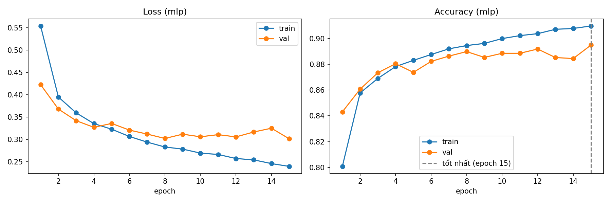
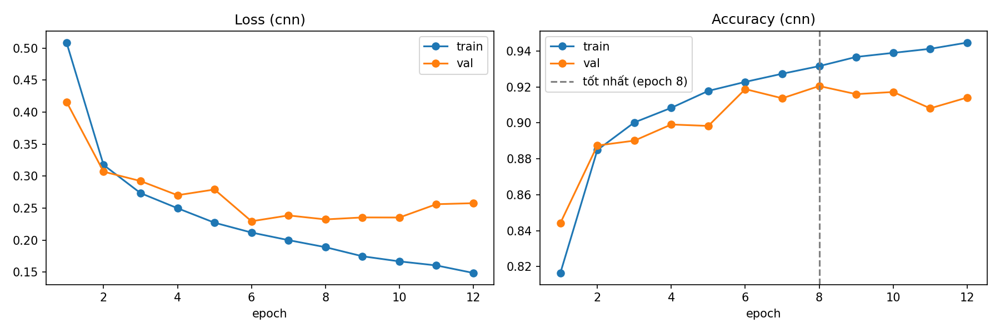
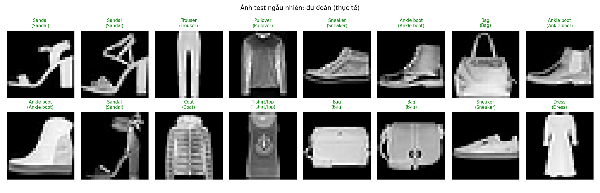
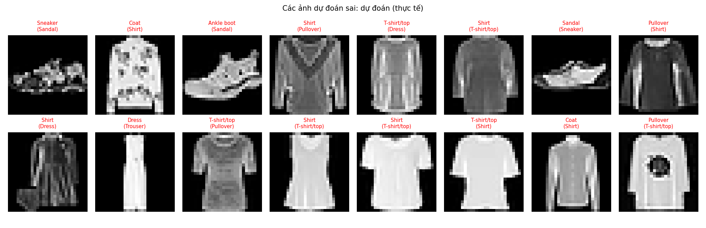
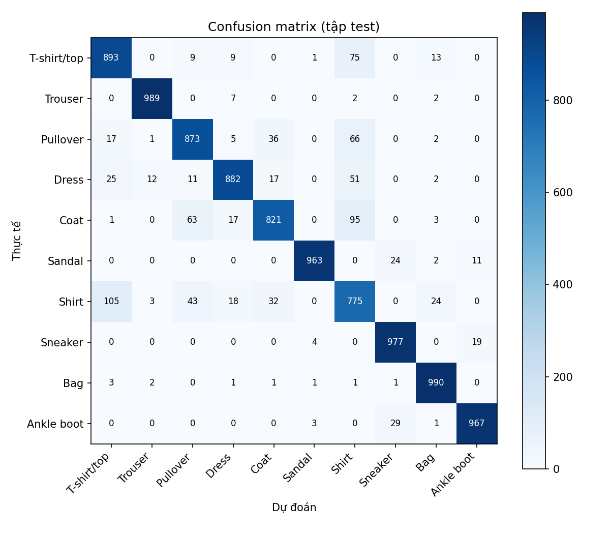

# BÁO CÁO THỰC HÀNH – CHAPTER 2
# PHÂN LOẠI FASHIONMNIST BẰNG PYTORCH

**Học phần:** Artificial Neural Networks – Chapter 2  
**Bài thực hành:** Practice 1 – FashionMNIST Classification  
**Công cụ:** Python, PyTorch, Torchvision, NumPy, Pandas, Matplotlib, Scikit-learn

---

## TÓM TẮT VÀ ĐỐI CHIẾU YÊU CẦU

Mục tiêu của bài thực hành là triển khai quy trình phân loại ảnh FashionMNIST bằng PyTorch và hoàn thành ba nhiệm vụ được giao:

1. Thử nghiệm với cấu trúc mạng hoặc siêu tham số (hyperparameters).
2. Trực quan hóa độ mất mát (visualize loss).
3. Hiển thị và so sánh ảnh dự đoán với nhãn thực tế (predicted vs actual).

MLP và CNN được sử dụng như **hai cấu trúc mạng trong thí nghiệm Task 1**. Việc so sánh hai kiến trúc chỉ nhằm quan sát ảnh hưởng của cách biểu diễn đầu vào và cấu trúc mạng; đây không phải mục tiêu duy nhất của bài lab.

| Task | Cách triển khai | Minh chứng |
|---|---|---|
| Task 1 – Network / hyperparameter experiment | Dùng cùng dataset, split, seed và thiết lập huấn luyện; thay đổi kiến trúc MLP ↔ CNN | `configs/mlp.yaml`, `configs/cnn.yaml`, `src/model.py`, kết quả validation/test |
| Task 2 – Visualize loss | Ghi train loss và validation loss sau từng epoch | `reports/mlp/training_curves.png`, `reports/cnn/training_curves.png`, `history.json` |
| Task 3 – Predicted vs actual | Vẽ ảnh test cùng nhãn dự đoán và nhãn thực tế; lưu ví dụ đúng và sai | `predictions_random.png`, `predictions_wrong.png` |

## 1. BÀI TOÁN VÀ DỮ LIỆU

FashionMNIST là bài toán phân loại ảnh đa lớp gồm 10 loại quần áo và phụ kiện. Mỗi ảnh grayscale có kích thước 28×28 pixel. Bộ dữ liệu gồm 60.000 ảnh train gốc và 10.000 ảnh test.

| Split | Số ảnh | Vai trò |
|---|---:|---|
| Train | 50.000 | Cập nhật trọng số |
| Validation | 10.000 | Theo dõi quá trình học và chọn checkpoint |
| Test | 10.000 | Đánh giá cuối cùng |

60.000 ảnh train gốc được chia train/validation bằng seed 42. Test set được giữ riêng. Pixel được chuyển về [0,1] rồi chuẩn hóa theo công thức:

`x_norm = (x - mean_train) / std_train`

Mean = 0,2858626 và std = 0,3529320 được tính chỉ từ training split để tránh data leakage. Notebook thực hiện EDA, kiểm tra nhãn, ảnh trống, ảnh trùng lặp, phân phối lớp, thống kê pixel, ảnh trung bình và PCA.

## 2. TASK 1 – THỬ NGHIỆM CẤU TRÚC MẠNG

Đề bài yêu cầu thử nghiệm cấu trúc mạng **hoặc** hyperparameters. Trong bài này, lựa chọn chính là thử nghiệm hai cấu trúc mạng khác nhau, giữ các điều kiện dữ liệu và huấn luyện cơ bản giống nhau để quan sát ảnh hưởng của kiến trúc.

### 2.1. Cấu hình thí nghiệm

| Thành phần | MLP | CNN |
|---|---|---|
| Cách biểu diễn đầu vào | Flatten ảnh thành 784 giá trị | Giữ tensor 1×28×28 |
| Cấu trúc chính | Linear 784→256→128→10 | Conv 1→32→64→128; pooling; classifier 1152→128→10 |
| Dropout | 0,2 | 0,25 |
| Số tham số | 235.146 | 241.994 |
| Batch size | 128 | 128 |
| Optimizer | Adam | Adam |
| Learning rate | 0,001 | 0,001 |
| Weight decay | 0,0001 | 0,0001 |
| Epoch tối đa | 15 | 15 |
| Loss | CrossEntropyLoss | CrossEntropyLoss |

**Biến được khảo sát:** cấu trúc mạng (fully connected MLP và convolutional CNN).  
**Các điều kiện được giữ cố định:** dataset, train/validation/test split, seed, batch size, optimizer, learning rate, weight decay và số epoch tối đa.

MLP dùng Flatten nên không giữ cấu trúc lân cận 2D của pixel. CNN dùng convolution để học đặc trưng cục bộ và giữ thông tin không gian. Hai cấu hình được lưu độc lập trong `configs/mlp.yaml` và `configs/cnn.yaml`; mô hình được định nghĩa trong `src/model.py`.

### 2.2. Kết quả của thí nghiệm kiến trúc

Theo lần chạy mới nhất được thực hiện trên máy local:

| Chỉ số | MLP | CNN |
|---|---:|---:|
| Best validation accuracy | 89,15% | 92,25% |
| Test accuracy | 88,34% | 92,20% |
| Test Macro-F1 | 88,35% | 92,15% |
| Test loss | 0,3276 | 0,2331 |
| Epoch thực chạy | 15 | 15 |

CNN đạt accuracy cao hơn 3,86 điểm phần trăm trong lần chạy này. Đây là kết quả quan sát của hai cấu hình cụ thể, không phải kết luận rằng CNN luôn tốt hơn mọi MLP.

**Lưu ý đồng bộ:** các file JSON kết quả đang được lưu trên GitHub có thể chưa phải lần chạy local mới nhất. Trước khi nộp, chạy lại train/evaluate hoặc đồng bộ thư mục `reports/mlp` và `reports/cnn` từ máy local để bảo đảm bảng số liệu và hình ảnh cùng thuộc một lần chạy.

## 3. TASK 2 – TRỰC QUAN HÓA LOSS

Trong mỗi epoch, chương trình ghi lại:
- `train_loss`: loss trung bình trên tập train.
- `val_loss`: loss trung bình trên tập validation.

Loss được tính bằng `CrossEntropyLoss`. Các giá trị được lưu trong `history.json`; hàm `plot_history()` tạo biểu đồ `training_curves.png`. Trục hoành là epoch, trục tung là loss. Hai đường train/validation giúp quan sát tốc độ học và khả năng tổng quát hóa.

### 3.1. Đường cong loss của MLP

### 3.2. Đường cong loss của CNN

### 3.3. Cách nhận xét biểu đồ

- Train loss giảm cho thấy mô hình đang học được từ dữ liệu huấn luyện.
- Nếu train loss tiếp tục giảm nhưng validation loss tăng kéo dài, đó có thể là dấu hiệu overfitting.
- Nếu cả hai loss còn cao và giảm chậm, mô hình có thể chưa học đủ hoặc cấu hình tối ưu chưa phù hợp.
- Không chỉ nhìn một epoch; cần xem xu hướng của cả hai đường và checkpoint được chọn bằng validation.

Biểu đồ accuracy có thể dùng làm thông tin bổ sung, nhưng minh chứng chính cho Task 2 là hai đường **Train Loss** và **Validation Loss**.

## 4. TASK 3 – HIỂN THỊ PREDICTED VS ACTUAL IMAGES

Sau khi đánh giá checkpoint trên test set, chương trình lấy các ảnh test, dự đoán lớp bằng `argmax(logits)`, sau đó hiển thị:
- Ảnh đầu vào.
- Nhãn mô hình dự đoán.
- Nhãn thực tế trong ngoặc.
- Màu xanh biểu thị dự đoán đúng; màu đỏ biểu thị dự đoán sai.

### 4.1. Ví dụ ảnh test và nhãn dự đoán/thực tế

Trong hình, tiêu đề mỗi ảnh có dạng **Predicted (Actual)**. Ví dụ `Sneaker (Sneaker)` nghĩa là mô hình dự đoán Sneaker và nhãn thực tế cũng là Sneaker.

### 4.2. Các trường hợp mô hình dự đoán sai

Hình này chỉ chứa các ảnh mà nhãn dự đoán khác nhãn thực tế. Quan sát các trường hợp này giúp nhận biết lớp nào dễ nhầm lẫn và vì sao những mặt hàng có hình dáng gần nhau có thể gây khó khăn cho mô hình.

Các ảnh được tạo bởi `show_predictions()` trong `src/utils.py` và được lưu tự động bởi `src/evaluate.py`. Có thể xem thêm kết quả MLP tại `reports/mlp/predictions_random.png` và `reports/mlp/predictions_wrong.png`.

## 5. QUY TRÌNH TRIỂN KHAI PYTORCH

Bài lab thực hành các thành phần chính của Chapter 2:

1. **Tensor:** biểu diễn ảnh và nhãn dưới dạng tensor.
2. **Dataset/DataLoader:** tải dữ liệu theo mini-batch.
3. **Transforms:** chuyển ảnh thành tensor và chuẩn hóa.
4. **Model building:** xây dựng MLP/CNN kế thừa `torch.nn.Module`.
5. **Autograd:** tính gradient tự động qua `loss.backward()`.
6. **Optimization:** cập nhật trọng số bằng Adam qua `optimizer.step()`.
7. **Save/load:** lưu checkpoint tốt nhất và nạp lại để đánh giá/dự đoán.

Training loop trong `src/train.py` thực hiện `zero_grad → forward → loss → backward → optimizer.step`. Sau mỗi epoch, validation được chạy để theo dõi mô hình và chọn checkpoint. Test set chỉ dùng cho đánh giá cuối cùng.

## 6. ĐÁNH GIÁ BỔ SUNG

Ngoài ba nhiệm vụ chính, project còn lưu Accuracy, Precision, Recall, Macro-F1 và Confusion Matrix. Các chỉ số này giúp đánh giá chất lượng phân loại trên 10 lớp; chúng là phần đánh giá bổ sung, không thay thế ba Task nêu trên.

- MLP: test accuracy 88,34%, Macro-F1 88,35%.
- CNN: test accuracy 92,20%, Macro-F1 92,15%.
- Lớp Shirt là một trong các lớp khó phân loại hơn trong lần chạy hiện tại.

Confusion Matrix:

## 7. KẾT LUẬN THEO ĐÚNG YÊU CẦU BÀI LAB

- **Task 1 – Thử nghiệm:** đã triển khai hai cấu trúc MLP và CNN với cấu hình tách biệt, giữ các điều kiện dữ liệu và huấn luyện cơ bản để khảo sát ảnh hưởng kiến trúc.
- **Task 2 – Visualize Loss:** pipeline lưu loss theo epoch và tạo biểu đồ Train Loss/Validation Loss.
- **Task 3 – Predicted vs Actual:** pipeline lưu ảnh dự đoán ngẫu nhiên và ảnh dự đoán sai, có hiển thị cả nhãn dự đoán lẫn nhãn thực tế.

Như vậy, trọng tâm bài thực hành là quy trình xây dựng, huấn luyện, quan sát loss và kiểm tra dự đoán bằng PyTorch. MLP/CNN là phương tiện thực hiện Task 1; phần so sánh chỉ đóng vai trò hỗ trợ giải thích kết quả.

## 8. TÀI LIỆU THAM KHẢO

1. [Fashion-MNIST – Zalando Research](https://github.com/zalandoresearch/fashion-mnist)
2. [PyTorch Tutorials](https://pytorch.org/tutorials/)
3. [PyTorch torch.nn](https://pytorch.org/docs/stable/nn.html)
4. [PyTorch Data Loading](https://pytorch.org/docs/stable/data.html)
