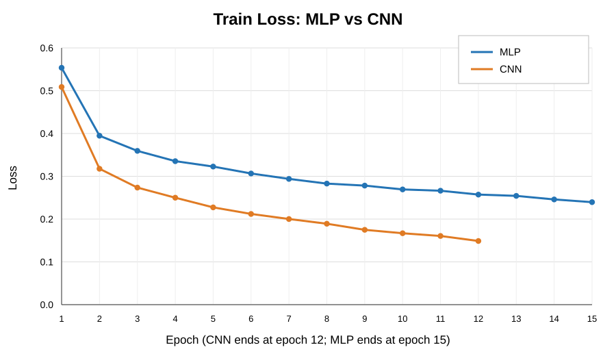
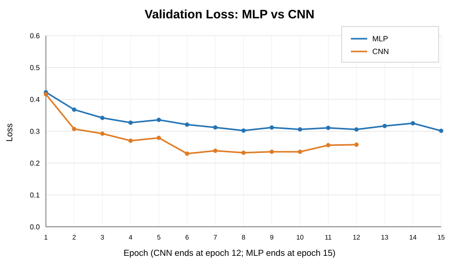
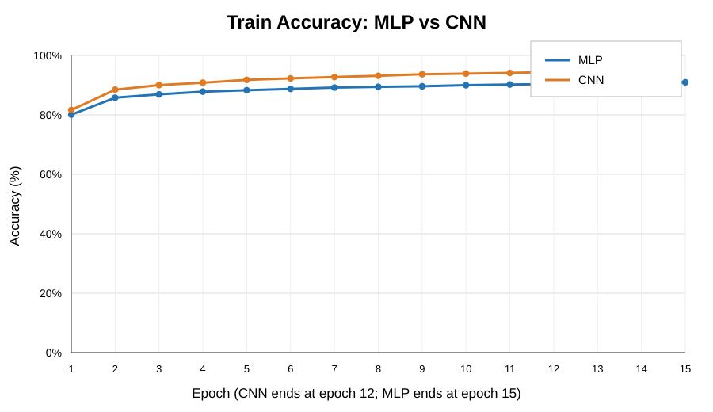
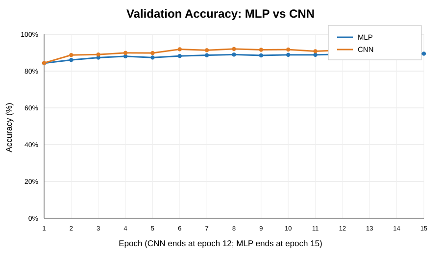

# BÁO CÁO THỰC HÀNH – CHAPTER 2
## FASHIONMNIST IMAGE CLASSIFICATION: MLP VS CNN

**Học phần:** Artificial Neural Networks / Deep Learning  
**Công cụ:** Python, PyTorch, Torchvision, Matplotlib, Scikit-learn  
**Bộ dữ liệu:** FashionMNIST  
**Phạm vi:** Hai mô hình MLP và CNN; không sử dụng ResNet18.

## TÓM TẮT
Bài thực hành xây dựng pipeline phân loại ảnh FashionMNIST bằng PyTorch và so sánh MLP với CNN. Hai mô hình được huấn luyện từ đầu, dùng cùng seed, cách chia dữ liệu và test set. CNN đạt test accuracy 91,30%, macro-F1 91,32%; MLP đạt test accuracy 88,65%, macro-F1 88,62%. CNN có chất lượng phân loại tốt hơn trong cấu hình thử nghiệm, trong khi MLP có thời gian huấn luyện và độ trễ suy luận thấp hơn.

## 1. GIỚI THIỆU
FashionMNIST là bài toán phân loại ảnh gồm 10 loại quần áo và phụ kiện. Mục tiêu là cài đặt hai cách tiếp cận: MLP sử dụng fully connected layers và CNN sử dụng convolution để khai thác đặc trưng không gian. Bài thực hành vận dụng Tensor, Dataset, DataLoader, transforms, forward pass, loss, backpropagation, optimizer, đánh giá và lưu/nạp mô hình.

## 2. CƠ SỞ LÝ THUYẾT
### 2.1. MLP
MLP gồm input layer, hidden layers và output layer. Ảnh 28×28 được Flatten thành vector 784 chiều. Kiến trúc: Linear(784,256) → ReLU → Dropout → Linear(256,128) → ReLU → Dropout → Linear(128,10). MLP đơn giản và phù hợp làm baseline, nhưng Flatten làm mất bố cục không gian hai chiều của ảnh.

### 2.2. CNN
CNN xử lý tensor ảnh 2D và dùng kernel convolution để học đặc trưng cục bộ. Mô hình sử dụng ba tầng convolution có 32, 64 và 128 kênh, kết hợp Batch Normalization, ReLU, Max Pooling, Adaptive Average Pooling và classifier 1152 → 128 → 10. CNN giữ được quan hệ không gian giữa các pixel và chia sẻ trọng số trong kernel.

### 2.3. Training loop
Với mỗi mini-batch: (1) forward tạo logits; (2) CrossEntropyLoss tính sai số; (3) loss.backward() lan truyền gradient ngược; (4) optimizer.step() cập nhật trọng số; (5) optimizer.zero_grad() xóa gradient trước batch kế tiếp. Validation được dùng chọn checkpoint; test set chỉ dùng đánh giá cuối cùng.

## 3. DỮ LIỆU VÀ TIỀN XỬ LÝ
FashionMNIST có 70.000 ảnh grayscale 28×28, gồm T-shirt/top, Trouser, Pullover, Dress, Coat, Sandal, Shirt, Sneaker, Bag và Ankle boot.

| Tập | Số ảnh | Mục đích |
|---|---:|---|
| Train | 50.000 | Cập nhật trọng số |
| Validation | 10.000 | Theo dõi và chọn checkpoint |
| Test | 10.000 | Đánh giá cuối cùng |

60.000 ảnh train gốc được chia train/validation với seed 42. Ảnh được chuyển thành tensor float32 và chuẩn hóa theo x_norm = (x − mean_train) / std_train. Mean/std chỉ tính từ train split để tránh rò rỉ dữ liệu. Input CNN có shape (B,1,28,28), còn MLP nhận vector 784 chiều sau Flatten.

## 4. THIẾT KẾ MÔ HÌNH VÀ THIẾT LẬP
| Đặc điểm | MLP | CNN |
|---|---|---|
| Input | Flatten 784 chiều | Ảnh 1×28×28 |
| Thành phần | Linear, ReLU, Dropout | Conv2D, BatchNorm, ReLU, Pooling |
| Cấu trúc | 784→256→128→10 | 1→32→64→128; GAP; 1152→128→10 |
| Không gian ảnh | Không giữ sau Flatten | Khai thác qua convolution |

| Tham số | Giá trị |
|---|---:|
| Seed | 42 |
| Batch size | 128 |
| Epoch tối đa | 15 |
| Optimizer | Adam |
| Learning rate | 0.001 |
| Loss | CrossEntropyLoss |
| Weight decay | 0.0001 |
| Early stopping patience | 4 |

Hai mô hình dùng cùng seed, cách chia dữ liệu và test set. Checkpoint được lựa chọn theo validation accuracy tốt nhất. CNN dừng sau 12 epoch, MLP chạy đủ 15 epoch. Thời gian train và latency phụ thuộc phần cứng và điều kiện đo.

## 5. KẾT QUẢ THỰC NGHIỆM
### 5.1. Bảng so sánh
| Chỉ số | MLP | CNN |
|---|---:|---:|
| Best validation accuracy | 89.48% | 92.05% |
| Test accuracy | 88.65% | 91.30% |
| Macro-F1 | 88.62% | 91.32% |
| Test loss | 0.3227 | 0.2473 |
| Training time | 21.88 s | 201.26 s |
| Inference latency | 0.0673 ms/ảnh | 0.2684 ms/ảnh |
| Số tham số | 235,146 | 241,994 |
| Epoch đã chạy | 15 | 12 |

CNN cao hơn MLP 2.65 điểm phần trăm về test accuracy và khoảng 2.71 điểm phần trăm về macro-F1. Test loss của CNN thấp hơn. Số tham số chênh lệch 6.848. Ngược lại, CNN mất nhiều thời gian huấn luyện và có latency cao hơn trong lần đo này.

### 5.2. Đường cong huấn luyện – so sánh trực tiếp
Cả bốn biểu đồ dùng chung trục X từ epoch 1 đến 15 và cùng giới hạn trục Y giữa MLP và CNN trong từng chỉ số. MLP có 15 điểm dữ liệu; CNN có 12 điểm và đường CNN kết thúc đúng tại epoch 12. Không nội suy hoặc thêm điểm giả. Accuracy được biểu diễn theo phần trăm.

**Train Loss**

**Validation Loss**

**Train Accuracy**

**Validation Accuracy**

Train loss giảm ở cả hai mô hình. Validation loss có dao động; CNN đạt giá trị thấp nhất khoảng 0.2296 tại epoch 6, sau đó tăng/dao động. Vì vậy cần theo dõi khoảng cách train-validation và lựa chọn checkpoint dựa trên validation thay vì mặc định lấy epoch cuối.

### 5.3. Phân tích theo từng lớp
| Lớp | MLP F1 | CNN F1 | Nhận xét |
|---|---:|---:|---|
| T-shirt/top | 0.8433 | 0.8738 | CNN tốt hơn |
| Trouser | 0.9798 | 0.9856 | Cả hai tốt |
| Pullover | 0.8042 | 0.8734 | CNN cải thiện rõ |
| Dress | 0.8894 | 0.9097 | CNN tốt hơn |
| Coat | 0.8127 | 0.8610 | CNN tốt hơn |
| Sandal | 0.9597 | 0.9767 | Cả hai tốt |
| Shirt | 0.6991 | 0.7506 | Lớp khó nhất |
| Sneaker | 0.9439 | 0.9621 | CNN tốt hơn |
| Bag | 0.9758 | 0.9711 | MLP nhỉnh hơn nhẹ |
| Ankle boot | 0.9539 | 0.9685 | CNN tốt hơn |

Shirt là lớp khó nhất với cả hai mô hình. CNN cải thiện F1 ở phần lớn lớp, nhưng Bag là ngoại lệ khi MLP đạt F1 cao hơn một lượng nhỏ. Cần xem kết quả theo lớp và confusion matrix, không chỉ accuracy tổng thể.

### 5.4. Confusion matrix và ví dụ dự đoán
- MLP: ../mlp/confusion_matrix.png, ../mlp/predictions_random.png, ../mlp/predictions_wrong.png.
- CNN: ../cnn/confusion_matrix.png, ../cnn/predictions_random.png, ../cnn/predictions_wrong.png.
Confusion matrix thể hiện các cặp lớp thường bị nhầm; ảnh dự đoán đúng/sai giúp kiểm tra trực quan hành vi mô hình.

## 6. THẢO LUẬN
### 6.1. Chất lượng phân loại
CNN có test accuracy và macro-F1 cao hơn trong cấu hình đã thử. Lợi thế này phù hợp với khả năng khai thác cấu trúc không gian ảnh. Đây là kết luận cho thực nghiệm hiện tại, không phải khẳng định mọi CNN luôn vượt mọi MLP.

### 6.2. Chi phí tính toán
MLP huấn luyện trong 21,88 giây và có latency 0,0673 ms/ảnh; CNN tương ứng 201,26 giây và 0,2684 ms/ảnh. CNN chậm hơn trong lần đo này dù số tham số chỉ chênh lệch nhỏ. Số tham số không phản ánh toàn bộ số phép toán; convolution và điều kiện thiết bị cũng ảnh hưởng thời gian.

### 6.3. Hạn chế
Thực nghiệm dùng một seed và một cấu hình chính cho mỗi kiến trúc. Thời gian đo thay đổi theo CPU/GPU, tải hệ thống, batch size và warm-up. Để so sánh chắc chắn hơn, nên chạy nhiều seed, giữ cùng điều kiện phần cứng và báo cáo trung bình cùng độ lệch chuẩn.

## 7. DATA AUDIT
Đề xuất thực hiện audit kỹ thuật nhẹ trước khi huấn luyện: xác nhận số lượng 60.000 ảnh train gốc và 10.000 ảnh test; ảnh grayscale 28×28; kiểu uint8 và miền pixel 0–255; nhãn 0–9; chia 50.000 train/10.000 validation với seed 42 và không giao nhau; đủ 10 lớp trong từng split; mean/std chuẩn hóa chỉ tính từ train split. Script nằm tại `src/data_audit.py`, hướng dẫn ở `docs/data_audit.md`. Cần chạy `python -m src.data_audit` trên môi trường thực tế trước khi đánh dấu PASS. Việc thêm script không đồng nghĩa audit đã được thực thi.

## 8. KẾT LUẬN
Bài thực hành đã triển khai pipeline phân loại FashionMNIST bằng PyTorch: tải dữ liệu, transforms, Dataset/DataLoader, xây dựng mô hình, forward, CrossEntropyLoss, backpropagation, Adam, validation, lưu/nạp checkpoint và đánh giá test. Trong kết quả hiện có, CNN đạt test accuracy 91,30% và macro-F1 91,32%, cao hơn MLP lần lượt 88,65% và 88,62%. CNN phù hợp hơn về chất lượng phân loại trong cấu hình thực nghiệm, trong khi MLP có lợi thế về thời gian huấn luyện và độ trễ suy luận.

## 9. HƯỚNG PHÁT TRIỂN
- Thử nhiều learning rate, batch size và cấu hình hidden/channel.
- Áp dụng data augmentation và learning-rate scheduler.
- Chạy nhiều seed để đánh giá độ ổn định.
- Đo latency riêng trên CPU/GPU sau warm-up.
- Phân tích sâu confusion matrix và các ảnh dự đoán sai.

## 10. TÀI LIỆU THAM KHẢO
1. https://github.com/zalandoresearch/fashion-mnist
2. https://pytorch.org/tutorials/
3. https://pytorch.org/docs/stable/nn.html
4. https://pytorch.org/docs/stable/data.html